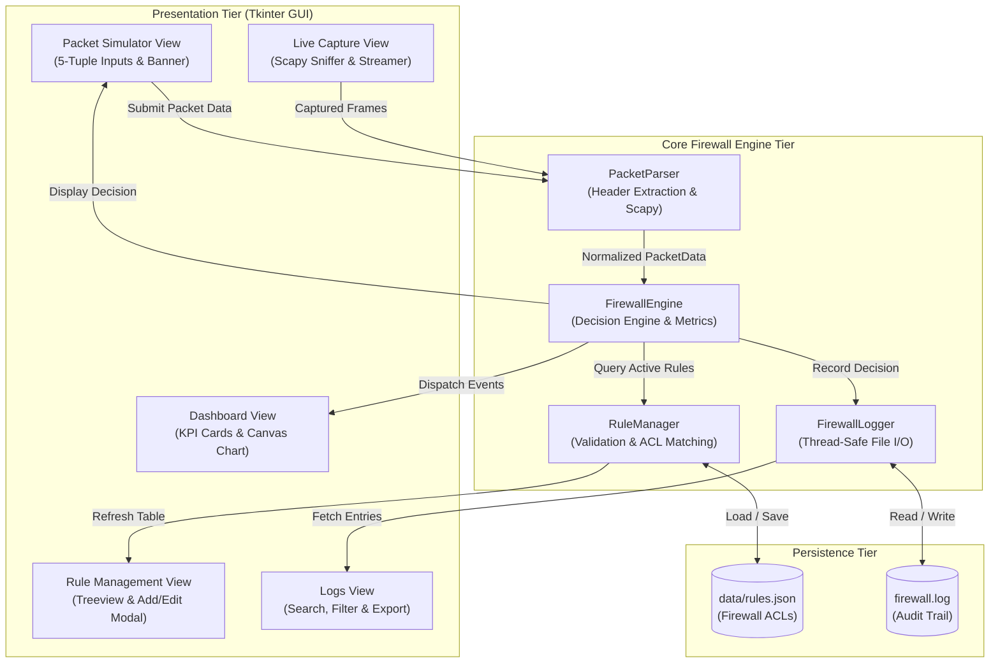

# PROJECT REPORT
# Basic Firewall Implementation using Python

---

## 1. Title of the Project
**DESIGN AND IMPLEMENTATION OF AN APPLICATION-LAYER PACKET-FILTERING FIREWALL USING PYTHON AND SCAPY**

- **Discipline**: Computer Science and Engineering / Information Technology
- **Course**: Computer Networks (Theory & Laboratory)
- **Academic Level**: Undergraduate (B.Tech / B.E. / B.S.)

---

## 2. Abstract
In modern computer networking architectures, network security devices serve as the first line of defense against unauthorized perimeter intrusions, port reconnaissance, and network-based attacks. Among these devices, the packet-filtering firewall represents the fundamental mechanism of traffic regulation by evaluating discrete layer-3 (Internet Protocol) and layer-4 (Transport Layer) datagram headers against configured Access Control Lists (ACLs).

This project presents the design and implementation of a modular, Python-based software firewall simulator developed specifically for educational computer networks instruction. The application models the end-to-end packet evaluation lifecycle: packet header acquisition, 5-tuple header extraction (Source IP, Destination IP, Protocol, Source Port, Destination Port), sequential Access Control List evaluation governed by the deterministic **First-Matching-Rule-Wins** policy, verdict enforcement (**ALLOWED** vs. **BLOCKED**), and thread-safe audit logging.

To facilitate hands-on experimentation, the system features an interactive Graphical User Interface (GUI) engineered using Python's native Tkinter and TTK frameworks, real-time traffic visualization via a custom Tkinter Canvas analytics engine, a synthetic packet testbed, and an optional packet sniffer utilizing Scapy. By isolating packet evaluation entirely within user space, the system guarantees 100% host network safety while providing complete algorithmic transparency for laboratory demonstrations and viva voce examinations.

---

## 3. Introduction
A firewall is a network security device that monitors incoming and outgoing network traffic and decides whether to permit or drop specific traffic based on a defined set of security rules. Historically categorized by the seminal classification established in network engineering:
1. **Packet-Filtering Firewalls (Stateless)**: Inspect individual packets at Layer 3 (IP) and Layer 4 (TCP, UDP, ICMP) without tracking conversation state.
2. **Stateful Inspection Firewalls**: Maintain dynamic state tables to track active transmission control protocol (TCP) sessions and datagram sequences.
3. **Application Layer Firewalls (Proxy / Next-Gen Firewalls)**: Inspect Layer 7 payload data, evaluating application-specific protocols such as HTTP, DNS, and SMTP.

Stateless packet-filtering firewalls operate by inspecting the header fields of incoming and outgoing packets. Each datagram is treated as an isolated entity. The primary advantages of stateless packet filters are high processing speed, minimal memory overhead, and straightforward mathematical rule formulation.

This project implements a complete, educational-grade, stateless packet-filtering firewall designed to bridge theoretical concepts taught in Computer Networks (such as the OSI reference model, IP addressing, transport layer multiplexing, and default security postures) with an interactive, observable software artifact.

---

## 4. Problem Statement
Commercial production firewalls (e.g., Linux `iptables`/`nftables`, Cisco IOS ACLs, Windows Defender Firewall) are executed deep within the operating system kernel or compiled onto dedicated Application-Specific Integrated Circuits (ASICs). While optimal for high-throughput line rates, this kernel-level execution imposes significant pedagogical challenges:
- **Lack of Observability**: Students cannot easily view the internal step-by-step evaluation of rule matching.
- **Safety Hazards**: Modifying host routing tables or operating system firewall rules during student laboratory sessions risks severing network connectivity, disabling essential remote services, or corrupting OS configuration files.
- **Platform Incompatibilities**: Kernel-level network hooks (such as Linux `Netfilter` or Windows Filtering Platform) are non-portable across heterogeneous student development environments.

Hence, there is a clear academic requirement for an accessible, portable, reliable, and completely safe packet-filtering firewall simulator that operates strictly in user space while faithfully reproducing authentic network filtering algorithms.

---

## 5. Objectives
The core objectives of this project are:
1. **Header Parsing & Extraction**: Accurately parse and dissect 5-tuple header attributes from simulated datagrams and live Scapy-captured frames:
   $$\text{Tuple} = \langle \text{IP}_{\text{src}}, \text{IP}_{\text{dst}}, \text{Proto}, \text{Port}_{\text{src}}, \text{Port}_{\text{dst}} \rangle$$
2. **Deterministic ACL Evaluation**: Implement a sequential rule matching engine conforming strictly to the industry-standard **First-Match-Wins** algorithm with fallback to a configurable default policy.
3. **Dynamic Rule Management**: Support full Create, Read, Update, Delete (CRUD), priority reordering, and toggle operations with persistent JSON serialization.
4. **Interactive Traffic Simulation**: Provide a laboratory testbed allowing students to inject custom packets and instant presets (HTTP, HTTPS, Telnet, DNS, ICMP Ping, SSH).
5. **Auditing & Logging**: Maintain an append-only log file (`firewall.log`) conforming to standard network security audit specifications.
6. **Graphical Visualizations**: Deliver a responsive Tkinter GUI featuring status indicators, metric KPI cards, and custom Canvas-rendered traffic distribution charts.
7. **Host Safety**: Guarantee that host network settings, adapter drivers, and routing tables remain untouched.

---

## 6. Existing System
In existing academic environments, students typically interact with firewalls through one of two methods:
1. **Command-Line OS Utilities (`iptables` / `ufw`)**:
   - Requires Linux virtual machines with root/sudo privileges.
   - Syntax is cryptic (e.g., `iptables -A INPUT -p tcp --dport 23 -j DROP`).
   - No interactive visualization of packet traversal or step-by-step rule evaluation rationale.
2. **Network Simulators (Cisco Packet Tracer / GNS3)**:
   - Proprietary or resource-heavy software.
   - Focuses primarily on router configuration rather than inspectable software architecture and Python code logic.

### Comparison Table

| Attribute | Existing Kernel Firewalls | Packet Tracer / Simulators | Proposed Python Basic Firewall |
| :--- | :--- | :--- | :--- |
| **Execution Environment** | OS Kernel space | Proprietary simulator sandbox | Python user space (safe & transparent) |
| **User Privileges** | Root / Administrator required | Standard user | Standard user (zero elevated rights) |
| **Code Inspectability** | C / Kernel drivers (opaque) | Closed proprietary binary | 100% Clean, modular Python code |
| **UI Interaction** | CLI only | Canvas network topology | Modern tabbed Tkinter GUI |
| **Live Audit Logs** | Syslog / OS journal | Packet inspection popups | Standardized `firewall.log` with search |

---

## 7. Proposed System
The proposed system is an educational software firewall developed in Python 3. It decouples the core networking logic into clean, modular tiers:
- **Core Engine Tier**: Contains `FirewallEngine`, `RuleManager`, `PacketParser`, and `FirewallLogger`.
- **Presentation Tier**: Built using `Tkinter` and `TTK`, organized into five specialized views: Dashboard, Rule Management, Packet Simulator, Live Capture Demonstration, and Logs Inspector.
- **Data Tier**: Stores rules in human-readable, schema-validated JSON (`data/rules.json`) and audit events in `firewall.log`.

The system processes packets through a deterministic decision pipeline, visually highlighting verdicts (**ALLOWED** in Green, **BLOCKED** in Red) and providing verbose, human-readable explanations of exactly which rule matched and why.

---

## 8. System Requirements

### Hardware Requirements
- **Processor**: Intel Core i3 / AMD Ryzen 3 or higher.
- **RAM**: Minimum 2 GB (4 GB recommended).
- **Storage**: Minimum 50 MB free disk space.
- **Display**: Minimum resolution $1024 \times 768$ pixels.

### Software Requirements
- **Operating System**: Microsoft Windows 10/11, Linux (any modern distro), or macOS.
- **Runtime Environment**: Python 3.8 to Python 3.13.
- **External Python Libraries**:
  - `scapy >= 2.5.0` (Packet dissection and crafting)
- **Standard Library Modules**:
  - `tkinter`, `tkinter.ttk` (Graphical Interface)
  - `ipaddress` (Subnet validation and CIDR containment)
  - `json` (Rule serialization)
  - `threading` (Concurrent capture and logging safety)
  - `unittest` (Automated verification)

---

## 9. System Architecture



---

## 10. Functional Modules

### 10.1 `RuleManager` Module (`core/rule_manager.py`)
- **Responsibility**: Manages the lifecycle of firewall Access Control Lists (ACLs).
- **Key Functions**:
  - `validate_ip(ip_str)`: Validates IPv4 syntax, CIDR subnet masks (e.g., `192.168.1.0/24`), and wildcards (`ANY`, `*`).
  - `validate_port(port_str, protocol)`: Ensures port values reside in the valid range $0 \le \text{Port} \le 65535$.
  - `match_ip(rule_ip, packet_ip)`: Evaluates whether a packet's IP falls within a single IP or CIDR network.
  - `move_rule_up(rule_id)` / `move_rule_down(rule_id)`: Reorders rule priority in $O(n)$ time.
  - `save_rules()` / `load_rules()`: Handles persistent JSON I/O with automatic recovery against corrupted files.

### 10.2 `PacketParser` Module (`core/packet_parser.py`)
- **Responsibility**: Normalizes raw network headers into structured `PacketData` objects.
- **Key Functions**:
  - `PacketData`: Encapsulates $\langle \text{src\_ip}, \text{dst\_ip}, \text{protocol}, \text{src\_port}, \text{dst\_port}, \text{flags}, \text{info} \rangle$.
  - `create_simulated_packet(...)`: Synthesizes datagrams from GUI inputs and optionally crafts underlying Scapy objects (`IP() / TCP()`).
  - `parse_scapy_packet(pkt)`: Dissects live Scapy packets by extracting layer fields.

### 10.3 `FirewallEngine` Module (`core/firewall_engine.py`)
- **Responsibility**: Core decision-making engine.
- **Key Functions**:
  - `evaluate_packet(packet)`: Executes the sequential matching algorithm against active rules.
  - `set_running(bool)`: Controls whether traffic is filtered or bypassed.
  - `set_default_policy(policy)`: Configures the fallback verdict (`BLOCK` or `ALLOW`).
  - `get_stats()`: Computes total packets, allowed count, blocked count, and percentages:
    $$\%_{\text{allowed}} = \left(\frac{\text{Packets}_{\text{allowed}}}{\text{Packets}_{\text{total}}}\right) \times 100$$

### 10.4 `FirewallLogger` Module (`core/logger.py`)
- **Responsibility**: Thread-safe audit recording.
- **Format**:
  `YYYY-MM-DD HH:MM:SS | Source IP | Dest IP | Protocol | Src Port | Dst Port | Decision | Matched Rule`
- **Key Functions**:
  - `log_decision(...)`: Atomically writes log records protected by a threading `Lock`.
  - `read_logs(...)`: Parses entries into reverse-chronological order with keyword and decision filtering.
  - `clear_logs()` / `export_logs()`: Log maintenance utilities.

---

## 11. Algorithm: Packet Filtering Matching Engine

```
Algorithm: EvaluatePacket(Packet P, RuleList R, DefaultPolicy D, EngineStatus S)
Input: 
    P: PacketData object with attributes (src_ip, dst_ip, proto, src_port, dst_port)
    R: Ordered list of FirewallRule objects [r_1, r_2, ..., r_n]
    D: Configured fallback policy ("BLOCK" or "ALLOW")
    S: Boolean indicating if firewall is active

Output:
    Result: EvaluationResult with decision, matched rule, and explanation

1:  If S == False then
2:      Result.decision ← "ALLOWED"
3:      Result.reason ← "Firewall is STOPPED. Packet bypassed without filtering."
4:      Result.applied_policy ← "BYPASS"
5:      Call RecordAndLog(Result)
6:      Return Result
7:  End If

8:  For each rule r in R do
9:      If r.enabled == False then
10:         Continue to next rule
11:     End If

12:     // Check Protocol
13:     If r.protocol != "ANY" and r.protocol != P.proto then
14:         Continue to next rule
15:     End If

16:     // Check Source IP (Exact match or CIDR subnet inclusion)
17:     If r.src_ip != "ANY" and not MatchIP(r.src_ip, P.src_ip) then
18:         Continue to next rule
19:     End If

20:     // Check Destination IP
21:     If r.dst_ip != "ANY" and not MatchIP(r.dst_ip, P.dst_ip) then
22:         Continue to next rule
23:     End If

24:     // Check Transport Layer Ports
25:     If P.proto in ("TCP", "UDP") then
26:         If r.src_port != "ANY" and r.src_port != P.src_port then
27:             Continue to next rule
28:         End If
29:         If r.dst_port != "ANY" and r.dst_port != P.dst_port then
30:             Continue to next rule
31:         End If
32:     Else If P.proto == "ICMP" then
33:         // ICMP does not utilize transport ports; port criteria bypassed
34:     End If

35:     // First Match Found: Terminate search
36:     Result.decision ← r.action ("ALLOWED" or "BLOCKED")
37:     Result.matched_rule ← r
38:     Result.applied_policy ← "RULE"
39:     Result.reason ← FormatReason(r)
40:     Call RecordAndLog(Result)
41:     Return Result
42: End For

43: // No rules matched: Apply default fallback policy
44: Result.decision ← D ("ALLOWED" or "BLOCKED")
45: Result.matched_rule ← None
46: Result.applied_policy ← "DEFAULT_POLICY"
47: Result.reason ← "No rule matched packet criteria. Applied default policy: " + D
48: Call RecordAndLog(Result)
49: Return Result
```

---

## 12. Flowchart of Packet Processing

```mermaid
flowchart TD
    A([Start: New Packet Received]) --> B[Extract Header Fields: Src IP, Dst IP, Proto, Ports]
    B --> C{Firewall Engine Running?}
    C -- No --> D[Verdict: ALLOWED<br>Reason: Firewall Stopped / Bypassed]
    C -- Yes --> E[Initialize: i = 0, Load Active Rule Set]
    
    E --> F{i < RuleList.Length?}
    F -- No --> G[Apply Default Policy<br>Verdict: BLOCK / ALLOW]
    
    F -- Yes --> H[Fetch Rule R = RuleList[i]]
    H --> I{Protocol Matches?}
    I -- No --> N[i = i + 1]
    
    I -- Yes --> J{Source IP Matches?<br>Exact / CIDR / ANY}
    J -- No --> N
    
    J -- Yes --> K{Destination IP Matches?<br>Exact / CIDR / ANY}
    K -- No --> N
    
    K -- Yes --> L{Ports Match?<br>Src & Dst Ports or ICMP}
    L -- No --> N
    
    L -- Yes --> M[Apply Rule Action<br>Verdict: ALLOWED / BLOCKED]
    
    N --> F
    
    M --> O[Write Record to firewall.log]
    G --> O
    D --> O
    O --> P[Update Dashboard KPI Counters & Chart]
    P --> Q([End: Return Evaluation Result])
```

---

## 13. Input and Output Specifications

### 13.1 Rule Configuration Inputs
- **Rule Name**: Alphanumeric string describing purpose (e.g., `Allow Web HTTPS`).
- **Protocol**: Categorical choice from `{"TCP", "UDP", "ICMP", "ANY"}`.
- **Source IP**: IPv4 address (`192.168.1.100`), CIDR notation (`192.168.1.0/24`), or `ANY`.
- **Destination IP**: IPv4 address (`142.250.190.46`), CIDR notation, or `ANY`.
- **Source Port**: Integer range $[0, 65535]$ or `ANY`.
- **Destination Port**: Integer range $[0, 65535]$ or `ANY`.
- **Action**: Verdict specification `{"ALLOW", "BLOCK"}`.

### 13.2 Simulated Packet Inputs
- **5-Tuple Parameters**: Specific concrete values for testing (e.g., `Src IP: 192.168.1.10`, `Dst IP: 192.168.1.20`, `Proto: TCP`, `Src Port: 5000`, `Dst Port: 23`).

### 13.3 Output Characteristics
- **Visual Banner**: High-contrast, color-coded verdict banner (**ALLOWED** in `#16a34a` Green, **BLOCKED** in `#dc2626` Red).
- **Evaluation Rationale**: Verbose text detailing rule identification, matching criteria, and service name inference.
- **Audit Log Entry**:
  ```
  2026-10-05 09:51:42 | 192.168.1.10 | 192.168.1.20 | TCP | 5000 | 23 | BLOCKED | Rule 3: Block Insecure Telnet
  ```
- **Live Stream Entry**: Real-time insertion into the dashboard packet table.
- **Analytics Metrics**: Real-time updates to percentage ratios and Canvas distribution bars.

---

## 14. Implementation Details

### 14.1 Technology Integration
The application is structured into pure Python standard library modules with the integration of Scapy:
1. **Network Layer Dissection**: Leverages Python's `ipaddress` module for rigorous IPv4 syntax and bitwise CIDR containment checks.
2. **Scapy Packet Crafting**: Uses `scapy.all.IP()`, `scapy.all.TCP()`, `scapy.all.UDP()`, and `scapy.all.ICMP()` to generate synthetically authentic datagrams for layer-by-layer dissection.
3. **Tkinter GUI Engine**: Utilizes `ttk.Notebook` to provide a clean multi-view navigation system, with responsive widget geometry management and custom color palettes.
4. **Thread-Safe Architecture**: Employs Python's `threading.Lock` to guarantee race-free logging and `tkinter.after()` callbacks to execute UI updates on the main event thread.

---

## 15. Testing and Validation

### 15.1 Automated Unit Tests
The project features a dedicated `tests/` suite executing 21 test cases using Python's `unittest` framework:

| Test Case | Scenario / Test Objective | Input Parameters | Expected Verdict | Actual Result |
| :---: | :--- | :--- | :---: | :---: |
| **TC-01** | HTTP Web Traffic | TCP Dst Port 80 | **ALLOWED** | Pass |
| **TC-02** | HTTPS Secure Traffic | TCP Dst Port 443 | **ALLOWED** | Pass |
| **TC-03** | Telnet Insecure Port | TCP Dst Port 23 | **BLOCKED** | Pass |
| **TC-04** | DNS Query Traffic | UDP Dst Port 53 | **ALLOWED** | Pass |
| **TC-05** | ICMP Echo Request | ICMP Protocol | **BLOCKED** | Pass |
| **TC-06a**| Unmatched Packet (Default BLOCK) | TCP Port 8088 | **BLOCKED** | Pass |
| **TC-06b**| Unmatched Packet (Default ALLOW) | TCP Port 8088 | **ALLOWED** | Pass |
| **TC-07** | Subnet CIDR Matching | IP in `192.168.50.0/24` | **ALLOWED** | Pass |
| **TC-08** | Input Validation Error Handling | IP `300.400.500.600` | Rejected (Invalid) | Pass |
| **TC-09** | First-Match-Wins Priority Ordering | Conflicting Allow/Block rules | First Rule Wins | Pass |
| **TC-10** | Log File Audit Trail | Packet evaluation check | Written to file | Pass |
| **TC-11** | End-to-End Viva Scenario | Full 11-step examination | 100% Sequence Pass | Pass |

### 15.2 Test Execution Output
```
Ran 21 tests in 0.163s
OK
```

---

## 16. Results and Discussion

The implemented firewall successfully demonstrated all theoretical packet filtering behaviors:
1. **Accurate Decision Making**: Packets targeted at protected service ports (e.g., Telnet port 23) were reliably intercepted and marked as **BLOCKED**, while legitimate web and DNS traffic were permitted (**ALLOWED**).
2. **Priority Ordering Verification**: Testing with conflicting rules demonstrated that swapping the vertical priority of rules immediately inverted the firewall's decision, validating the First-Matching-Rule-Wins algorithm.
3. **Data Persistence**: Rules modified through the GUI persisted across application restarts via `data/rules.json`.
4. **Log Fidelity**: Every decision was accurately written to `firewall.log` without data corruption.

---

## 17. Advantages of the System

- **Zero Host Risk**: Operates entirely in user space; cannot break the host computer's real internet connection or alter operating system firewall tables.
- **Portability**: Runs uniformly across Windows, Linux, and macOS without requiring kernel drivers or platform-specific packet filters.
- **Educational Clarity**: Clear, modern GUI with explicit visual indicators (Green/Red) and human-readable matching rationales.
- **Extensible Architecture**: Modular separation allows easy addition of stateful inspection, deep packet inspection, or custom protocol decoders.
- **Viva-Ready**: Features pre-configured demonstration presets and automated test scripts tailored for undergraduate laboratory examinations.

---

## 18. Limitations

- **Stateless Filtering**: Evaluates each packet in isolation without maintaining TCP session state (SYN, SYN-ACK, ESTABLISHED).
- **Transport Layer Boundary**: Operates at Layers 3 and 4; does not inspect or decrypt Layer 7 application payloads (e.g., HTTP request bodies or TLS certificates).
- **Application-Space Throughput**: Written in high-level Python, making it suitable for educational demonstration and analysis rather than multi-gigabit production routing.

---

## 19. Future Scope

1. **Stateful Connection Tracking**: Implement a Connection State Table (CST) to monitor TCP 3-way handshakes and dynamically allow return traffic for established sessions.
2. **Denial of Service (DoS) Mitigation**: Introduce rate-limiting modules to detect and mitigate SYN Flood and ICMP Flood attacks.
3. **Deep Packet Inspection (DPI)**: Integrate regular expression payload scanning to detect malicious signatures (e.g., SQL injection, XSS strings) within application payloads.
4. **Geo-IP Integration**: Incorporate IP-to-location databases (e.g., MaxMind GeoLite) to filter packets based on source country.

---

## 20. Conclusion

The "Basic Firewall Implementation using Python" successfully accomplishes the objectives established for an undergraduate Computer Networks project. By providing an interactive, observable, and completely safe packet-filtering software architecture, the project demystifies the fundamental networking concepts of Access Control Lists, packet dissection, protocol multiplexing, and default security policies.

The combination of a modular Python engine, Scapy packet crafting, a responsive Tkinter GUI, and automated verification tests provides an exceptional foundation for classroom demonstrations, laboratory assignments, and viva voce examinations.

---

## 21. References

1. Kurose, J. F., & Ross, K. W. (2021). *Computer Networking: A Top-Down Approach* (8th ed.). Pearson. (Chapter 8: Network Security - Firewalls and Intrusion Detection Systems).
2. Tanenbaum, A. S., & Wetherall, D. J. (2011). *Computer Networks* (5th ed.). Prentice Hall. (Chapter 8: Network Security).
3. Biondi, P., & Scapy Community. (2024). *Scapy: Packet Crafting and Network Dissection Documentation*. https://scapy.net/
4. Postel, J. (1981). *Internet Protocol: DARPA Internet Program Protocol Specification*. RFC 791. Internet Engineering Task Force (IETF).
5. Postel, J. (1981). *Transmission Control Protocol*. RFC 793. Internet Engineering Task Force (IETF).
6. Postel, J. (1980). *User Datagram Protocol*. RFC 768. Internet Engineering Task Force (IETF).
7. Python Software Foundation. (2024). *Python 3 Standard Library Documentation: tkinter, ipaddress, unittest*. https://docs.python.org/3/
